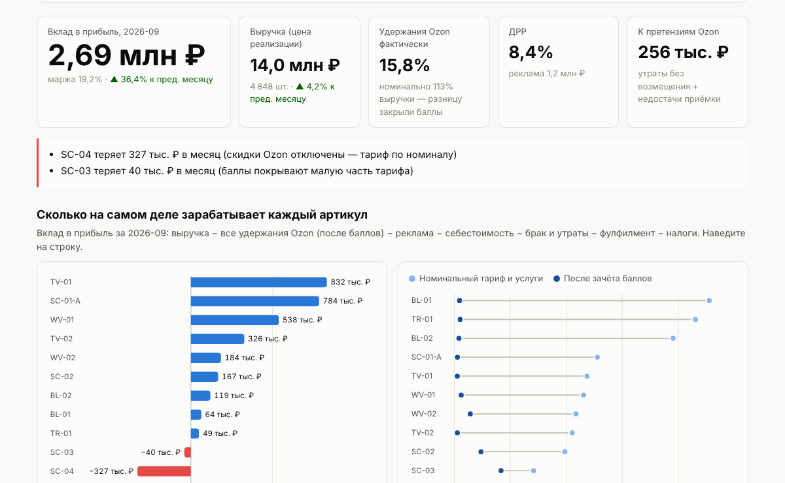
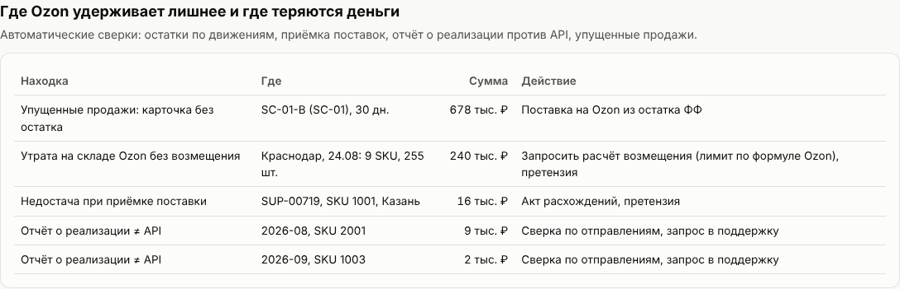
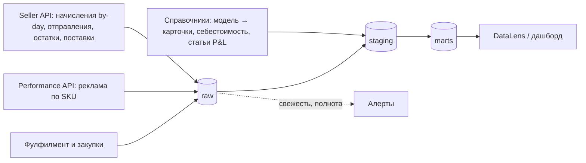

# Ozon Seller BI

**Сколько на самом деле зарабатывает каждый артикул, где Ozon удерживает лишнее и что закупать — по цифрам, а не по ощущениям.**

Это прототип системы аналитики для бренда, который продаёт на Ozon: от сбора данных через
Seller API до витрин, по которым собственник и финансовый директор принимают решения каждый день.
Репозиторий работает «из коробки» на синтетических данных и рассчитан на подключение боевого
кабинета за первую неделю.



Тот же дашборд собран в Yandex DataLens из выгрузки витрин в CSV: [открыть дашборд](https://datalens.yandex/5cajhqt3ldlco?_share_link=public)
(без входа). Инструкция по сборке и проверочные цифры — в [docs/08](docs/08_datalens.md).

## Пять идей, на которых всё держится

1. **Номинальный тариф Ozon — не расход.** В 2026 году вознаграждение считается от цены продавца,
   а баллы за скидки Ozon гасят до 99% услуг. Пока баллы не «пришиты» к артикулу, по заказу
   всё убыточно, а в конце месяца появляется большой плюс без SKU. Модель возвращает баллы к SKU
   и показывает фактический тариф каждого артикула → [docs/03](docs/03_unit_economics.md).
2. **Деньги — из начислений, разрезы — из операций.** Итог по деньгам — `total_amount`
   финансовых начислений (сходится с кабинетом), SKU/кластер/кампания — из заказов, остатков и рекламы.
3. **Сверки — ежедневный процесс, а не разовая акция.** Баланс остатков по движениям, приёмка поставок,
   отчёт о реализации против API, реклама против финансов, утраты против возмещений → [docs/04](docs/04_reconciliation.md).
4. **Закупка — по модели, поставки — по карточке и кластеру.** Один товар в двух карточках —
   это один остаток на фулфилменте и одна закупка → [docs/05](docs/05_planning.md).
5. **Мониторинг свежести данных, а не «скрипт отработал».** В сентябре 2026 Ozon тихо отключил
   финансовый метод API; синк «был зелёным», а прибыль считалась по пустым данным → [docs/06](docs/06_ozon_api_notes_2026.md).

## Что находит система на демо-данных

В синтетические данные заложены 13 типовых ситуаций. Витрины находят их сами, а тесты проверяют,
что найдено именно то, что заложено (`tests/test_pipeline_finds_scenarios.py`).

| # | Ситуация | Где видно |
|---|---|---|
| S1 | Скидки Ozon отключены у одного SKU → тариф по номиналу, маржа −22% | Вклад по SKU, удержания номинал = факт |
| S2 | Премиальная модель с мелкой скидкой Ozon → баллы закрывают малую часть тарифа | Фактический тариф 42% |
| S3 | Вторая карточка той же модели не пополняется → 30 дней OOS при товаре на ФФ | Упущенные продажи, срочная поставка |
| S4 | Закупка садовой техники на падающий сезон | Затоваривание по моделям |
| S5 | Брак аккумуляторов → возвраты с утилизацией | Возвраты, списание брака |
| S6 | Автоподключённый «Сбор отзывов» + возвраты после отзыва | Статья «Платные отзывы» |
| S7 | Утрата остатка на складе кластера; возмещение только по 2 SKU из 11 | Претензии: 240 тыс. ₽ |
| S8 | Недостача 12 шт. при приёмке поставки | Сверка приёмки |
| S9 | Отчёт о реализации расходится с API в двух SKU-месяцах | Сверка реализации |
| S10 | Performance API без данных за 2 дня | Реклама: финансы vs кампании −6,5% |
| S11 | Новый тип начисления без маппинга | Контроль качества |
| S12 | Штраф пришёл только итогом, без детализации | Нераспределённый остаток |
| S13 | К росту спроса в Q4 закупили мало | Рекомендация заказа по модели |



## Быстрый старт

```bash
git clone https://github.com/IlyaErmolaev1606/ozon-seller-bi.git
cd ozon-seller-bi
make install      # или: pip install -r requirements-dev.txt
make demo         # синтетические данные → витрины DuckDB → dashboard/index.html
make datalens     # витрины → datalens/*.csv для подключения «Файлы» в DataLens
make test         # 37 тестов: расчёты, разбор API, сверки, выгрузка для DataLens
```

На своих данных:

```bash
cp .env.example .env   # Client-Id, Api-Key и дата истечения ключа
PYTHONPATH=src python -m osbi.extract --since 2026-09-01 --to 2026-09-30 --out data/live
PYTHONPATH=src python -m osbi.build --data data/live
```

## Как устроено



```
src/osbi/
  ozon_client.py     клиент Seller API: ретраи, лимиты, курсорная пагинация, срок жизни ключа
  extract.py         выгрузка в raw по дням + журнал свежести источников
  flatten.py         разбор дерева начислений: total_amount — источник истины
  load.py            загрузка в DuckDB (raw/ref)
  unit_economics.py  ценовой калькулятор, акции, сценарии тарифов (с механикой баллов)
  forecast.py        спрос с поправкой на OOS, закупка по модели, поставки по кластерам, ABC/XYZ
  dashboard.py       статичный дашборд (прототип того, что живёт в DataLens)
  export_datalens.py выгрузка витрин в CSV для DataLens: формат загрузчика, сходимость цифр
  demo_data.py       генератор синтетических данных с заложенными ситуациями
sql/staging, sql/marts   вся бизнес-логика расчётов — в SQL
config/params.toml       налоги, допуски сверок, параметры планирования
data/reference/          справочник SKU и маппинг статей начислений
datalens/                витрины в CSV, готовые к загрузке в DataLens
docs/                    подход, архитектура, формулы, сверки, планирование, API-2026, план 30/60/90
```

## Документация

1. [Задача и подход](docs/01_approach.md)
2. [Архитектура и модель данных](docs/02_architecture.md)
3. [Юнит-экономика и механика баллов](docs/03_unit_economics.md)
4. [Сверки: где Ozon удерживает лишнее](docs/04_reconciliation.md)
5. [Спрос, закупки, поставки по кластерам](docs/05_planning.md)
6. [Seller API и правила Ozon в 2026 году](docs/06_ozon_api_notes_2026.md)
7. [План 30/60/90 и подводные камни](docs/07_plan_and_risks.md)
8. [Дашборд в Yandex DataLens](docs/08_datalens.md)

## Честно о допущениях

* **Данные синтетические.** Товары и цифры придуманы; совпадение категорий с реальными брендами — только
  ради правдоподобия механик.
* **Форма ответа `/v1/finance/accrual/by-day`** взята из публичного разбора миграции; вложенные поля
  в генераторе — допущение. Разбор устойчив к форме дерева (рекурсивный обход), но маппинг `type_id`
  и привязка баллов к SKU калибруются на первом закрытом месяце реального кабинета.
* **Тарифы логистики и хранения в генераторе иллюстративные**; в расчётах на боевых данных тарифы
  не используются вообще — берутся фактические начисления.
* **Прогноз — простой и прозрачный.** Усложнять имеет смысл после появления метрики точности и
  длинной истории.

---

Автор: Илья Ермолаев — аналитик данных (Лента, Утконос): коммерческая отчётность в Power BI,
прогнозирование спроса и автозаказ, данные API Ozon и Wildberries.
Telegram [@ioermolaev](https://t.me/ioermolaev) · ioermolaev1606@gmail.com
