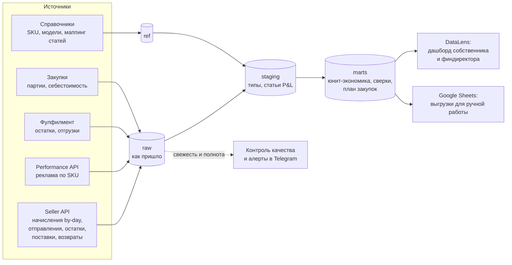

# 2. Архитектура и модель данных

## Слои

| Слой | Что лежит | Правило |
|---|---|---|
| `raw_*` | Ответы API и файлы как есть | Не меняем. Начисления — файл на день, повторная выгрузка дня идемпотентна по `accrual_id` |
| `ref_*` | SKU → модель → категория; себестоимость партий; маппинг `type_id` → статья P&L | Ведёт аналитик, правит финдиректор. Новый `type_id` без маппинга → алерт |
| `stg_*` | Типизированные таблицы, статья P&L у каждой строки начислений, движения остатков | Без бизнес-логики распределения |
| `mart_*` | Готовые ответы на вопросы | Каждая витрина — один вопрос, правила распределения прописаны явно |

## Модель данных (ключевые сущности)

* **Начисление** (`accrual_id`) → строки по `type_id` → статья P&L. SKU берётся из товара в отправлении
  или из `item.sku`; если в записи несколько SKU, общие строки не угадываются, а распределяются в витрине.
* **Отправление** (`posting_number`) → SKU, кластер отгрузки и кластер покупателя, статус, цена продавца
  и цена для покупателя (их разница — база баллов).
* **Остаток** (дата × SKU × кластер) + движения (приёмка, отгрузка, возврат в сток) → баланс,
  необъяснённая разница → утрата/излишек.
* **Модель** (физический товар) ⊃ карточки (SKU). Остаток ФФ и закупки — на уровне модели.
* **Партия закупки** → себестоимость «до склада»: цена у фабрики × курс + доставка партии + таможня/НДС.
  В прототипе — одна себестоимость на SKU; в проде — средневзвешенная по партиям в остатке.

## Хранилище и инструменты: решение

| Вариант | Плюсы | Минусы | Когда |
|---|---|---|---|
| **DuckDB (прототип, этот репозиторий)** | Ноль инфраструктуры, SQL как в проде, тесты за секунды | Один пользователь, нет коннектора DataLens | Неделя 1–2: калибровка на боевых данных |
| **PostgreSQL (Managed) + DataLens** | Дешево, DataLens подключается напрямую, права доступа | Нужна облачная учётка и бюджет | Целевой вариант для дашборда |
| ClickHouse + DataLens | Скорость на больших объёмах | Избыточно для одного кабинета | Если появятся WB/ЯМ и миллионы строк |
| Только Google Sheets + Apps Script | Привычно команде | Хрупко, нет версионирования логики, лимиты | Для справочников и ручного ввода — да, для логики — нет |

SQL-модели написаны на диалекте, близком к PostgreSQL; перенос — замена типов и `filter (where …)`
остаётся как есть. Любые платные сервисы — только после согласования бюджета.

## Расписание и надёжность

* Ежедневно в 06:00: начисления за 7 последних дней (Ozon доначисляет задним числом), отправления,
  остатки, Performance API за вчера; пересборка витрин; проверки качества.
* Раз в месяц: отчёт о реализации и акты (после закрытия периода) → сверка с API.
* Алерт в Telegram, если: источник «протух» (нет новых данных при наличии заказов), появился новый
  `type_id`, сверка вышла за допуск, до истечения API-ключа ≤ 14 дней.
* Ключи — в секретах, не в коде; доступ к витринам — по ролям (собственник, финдиректор, логистика).
